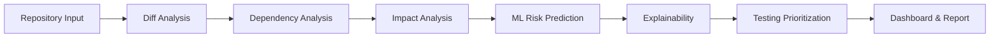
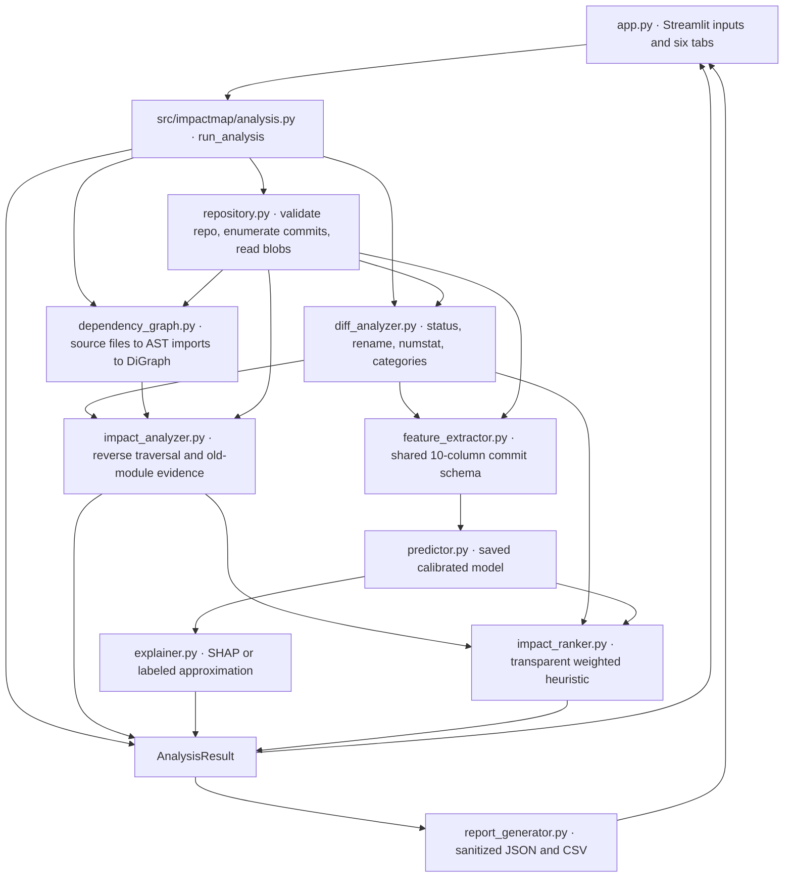

# ImpactMap architecture

## End-to-end flow

The diagram is the user-facing pipeline. In implementation, graph construction and commit feature extraction are independent analyses of the selected Git commit; the orchestrator combines them. Prediction and explanation are optional. When the model cannot load or score, graph impact and heuristic prioritization continue without the ML component.

## Module-level data flow

### Repository and diff

`repository.py` validates local Git repositories, rejects empty repositories, lists commit metadata, and reads blobs directly from trees without checking out or importing project files. Remote clone URLs are normalized HTTPS URLs on configured hosts. The clone subprocess uses argument-list invocation, `shell=False`, a timeout, no hooks, no submodules, and bounded history depth.

`diff_analyzer.py` compares a commit against its first parent, or the empty tree for an initial commit. Merge commits are compared with the first parent. Git rename detection maps old to new paths; `--numstat` provides line additions/deletions and marks binary rows. If the parent is missing at a shallow boundary, analysis falls back to the empty tree and marks history as truncated.

### Dependency and impact analysis

`dependency_graph.py` enumerates Python blobs within configured file and per-file byte caps, detects source roots such as `src/`, parses imports with Python's AST module, and constructs a directed `networkx.DiGraph`. Edges carry import statements and line numbers. Standard-library and other external imports are recorded separately from unresolved imports. A syntax-error file remains an isolated graph node with a parse-failure record.

**Edge convention:** `A → B` means **A imports B**. A changed module's dependents are found by walking the graph in reverse. Deleted or renamed module analysis also builds the graph at the parent commit, then checks which old importers remain in the current graph. This can expose a caller that still imports the removed path.

### Commit model and explanation

`feature_extractor.py` computes the ten model columns from the selected commit's diff and bounded history. The ordered feature names and data types are checked against `models/feature_schema.json`. `predictor.py` loads `models/model.joblib`, validates the saved feature order, and returns an explicit unavailable result when loading or inference fails. `explainer.py` uses SHAP when possible; if SHAP fails and saved training medians exist, it computes a one-feature-at-a-time baseline substitution and labels that method as an approximation.

The ML output is a commit-level score. `impact_ranker.py` computes a separate file-level heuristic priority using available graph and diff evidence. The same commit risk value applies to every file, so it can shift scores and tier boundaries but cannot change pairwise file ordering by itself. When history or ML is unavailable, the associated ranking weight is omitted and the remaining weights are renormalized.

## Caching and invalidation

| Layer | Key / policy | Invalidation behavior |
|---|---|---|
| Dependency graph (`dependency_graph.py`) | Process-local dictionary keyed by repository working/Git directory, commit SHA, and `AppConfig.config_hash()` | A different commit or configuration produces a different entry. Git commit objects are immutable. There is no time-based expiry or explicit size bound on this graph cache. |
| Full analysis (`analysis.py`) | Repository Git directory, commit SHA, configuration hash, and model identity | Model identity includes model version and artifact size/mtime when loadable; unavailable identity includes missing/stat state. Cache holds at most 16 analysis entries and evicts the oldest inserted entry. `clear_analysis_cache()` explicitly clears it. |
| Loaded model (`predictor.py`) | Resolved model, schema, and metrics paths; `lru_cache(maxsize=4)` | A new path tuple gets a separate entry. Tests can clear the private loader cache. Replacing a model at the same path does not automatically clear this loader cache within a running process. |
| Streamlit repository resources (`app.py`) | `st.cache_resource` for opened and cloned repositories | Cleared by Streamlit cache controls or process restart; no TTL is configured. |
| Streamlit commit list and model metrics (`app.py`) | Commit rows are effectively keyed by repository path and search text, with a 60-second TTL; metrics JSON uses a 300-second TTL | The commit-row function receives HEAD SHA as `_head_sha`, but Streamlit excludes underscore-prefixed arguments from cache hashing. A newly created commit can therefore leave the list stale until the 60-second TTL expires or the cache is cleared. Metrics refresh on TTL expiry or Streamlit cache clearing. |

Changing a selected commit or analysis configuration invalidates the displayed result in the UI and requires a new analysis. Restart the app after replacing the model artifact so the predictor's cached loader cannot retain a prior model object.

## Security boundary and residual risk

ImpactMap reads Git objects and parses source text; it does not execute repository source. It does invoke Git functionality through GitPython and uses a direct `subprocess.run` for validated remote cloning. Clone policy rejects non-HTTPS schemes and embedded credentials, restricts hosts, disables submodules and hooks, and applies a timeout. Current defaults cap graph indexing at 500 Python files and 1 MiB per blob; patch display is capped separately. Reports omit source contents and sanitize common credentials, emails, and absolute paths.

These measures are not a complete sandbox. Git object parsing, diff generation, malformed trees, parser and dependency vulnerabilities, pathological import graphs, and repositories with large histories or many large non-Python blobs may still consume resources or exercise implementation bugs. The clone timeout limits clone duration, not all later analysis. Local paths are intentionally permitted by default, so the user must trust the selected local repository. Host allowlisting also does not establish that repository content is safe. Run untrusted repositories in an isolated environment with OS-level resource limits, and do not treat a low risk score or the absence of detected imports as proof of safety.
